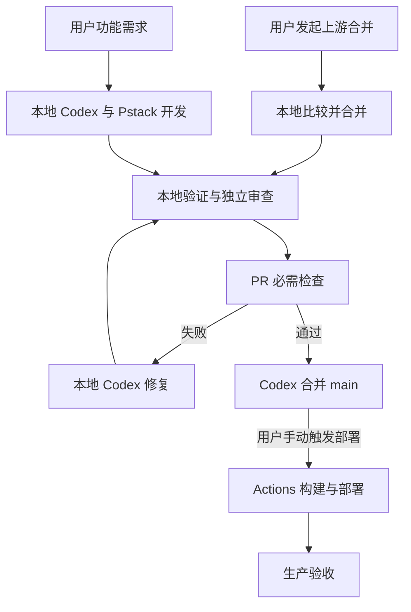

适用仓库 `krus1995/subboost`。生产地址 `https://subboost.krus1987.kdns.fr/`。本手册供 Codex Agent 直接执行，目标是接管现有原版部署，建立二次开发、用户发起的本地上游合并、验证和手动发起的腾讯云部署的完整流程。

用户已确认原版应用和 Cloudflare Tunnel 均已上线。执行起点是现有生产服务。2026 年 11 月 7 日编制，2026 年 11 月 8 日更新，采用用户发起的本地上游合并，以及公网 SSH root 密码部署流程。

# 0 给接手 Agent 的执行指令

收到用户“执行本手册”的指令后，按本手册逐阶段实施，持续推进到第 16 节验收完成。先读取仓库现有规则、当前工作区和服务器状态，再修改项目。将本文件保存到仓库 `docs/fork/AGENT_RUNBOOK.md`，让后续会话继续使用同一份规则。

本次任务包含以下授权范围。

- 在 `krus1995/subboost` 中建立开发规范、项目技能、检查脚本、GitHub Actions 和必要的分支规则。

- 为用户当前开发任务创建功能分支和 PR，完成验证与合并。用户发起上游更新任务后，由本地 Codex 处理上游合并、冲突、检查和交付。

- 为现有 SubBoost 服务建立备份、制品传输、镜像切换、健康验证和约定的回滚流程，后续通过 Actions 手动发布。

- 在腾讯云现有 SubBoost 目录和资源范围内完成接管，继续使用现有生产域名、数据库、密钥和 Tunnel 路由。

- 使用 Pstack 协调调查、实现、独立审查、验证和交付。通用技能里的逐次部署确认默认值，按这份明确授权调整。

每个阶段提交可审查的结果和执行证据。运行时要求的登录、Hook 信任和权限授予仍需完成。发现缺失凭据时，先完成不依赖它的工作，再一次列出具体缺项、设置位置和影响，已有授权范围内的常规步骤继续执行。

生产数据恢复到旧时间点、生产密钥轮换、域名迁移、数据库大版本升级、扩大到其他服务的变更，需要单独说明具体影响并取得对应授权。当前任务的发布回滚边界见第 11 节。

交付状态使用 `completed`、`blocked` 或 `failed`，并附证据。凭据缺失或生产验证失败的阶段应保留真实状态。

# 1 项目基线与实施默认值

## 1.1 已知事实

| 项目 | 当前信息 | Agent 接手动作 |
| - | - | - |
| 用户 fork | `https://github.com/krus1995/subboost` | 核对登录账号、仓库权限及默认分支 |
| 上游 | `https://github.com/SubBoost/subboost` | 配置为 `upstream`，读取最新发布记录 |
| 生产网站 | `https://subboost.krus1987.kdns.fr/` | 验证首页、健康接口和实际版本 |
| Tunnel | 用户确认已接通 | 记录当前路由、连接器运行方式和容器网络 |
| 开发 Agent | Codex | 检查实际执行程序、配置目录和 Pstack 加载情况 |
| 服务器 | 腾讯云，历史主机名 `VM-0-9-debian` | 通过现有可信 SSH 路径确认 |
| 管理地址 | 腾讯云服务器公网 IP，待填入 `DEPLOY_HOST` | 从实例控制台或已核对的服务器记录确认 |
| SSH 登录 | 用户 `root`，使用用户提供的密码 | 核对实际 SSH 端口，初始按 `22` 配置 |
| 系统资源 | 历史记录为 Debian 13、amd64、约 1.7 GiB RAM、2 GiB swap、50 GB 磁盘 | 记录当前资源余量 |
| 应用目录 | 历史记录为 `/opt/subboost` | 从 Compose 标签与挂载确认 |
| 服务 | 历史 Compose 服务名 `app`、`db`、`cron` | 读取实际项目名、容器名和网络 |
| 本机入口 | 历史绑定 `127.0.0.1:3108` 到容器 `3000` | 现场核对后写入运行配置 |
| 数据库 | 历史记录为 PostgreSQL 16 | 核对当前镜像、版本和数据卷 |

服务器数据来自此前部署记录，首次预检以现场结果为准。用户最新确认的线上地址和 Tunnel 状态作为当前接管基线。

仓库读取时，fork 与上游 `main` 均为 `401534742802e2b1542783197ce66451bad82739`，根包版本为 `2.11.0`。执行时重新读取实际提交。Git tag 对象、源码提交、镜像 ID 和镜像仓库 digest 分别记录。[仓库](https://github.com/krus1995/subboost) · [上游](https://github.com/SubBoost/subboost)

## 1.2 本手册采用的默认配置

这些默认值可由用户后续明确调整，Agent 应先按本表落实。

| 配置 | 默认值 |
| - | - |
| 生产分支 | fork 的 `main` |
| 上游跟踪对象 | 最新正式 Release，排除 draft 和 prerelease |
| 同步方式 | 用户发现更新后发起本地 Codex 任务，合并上游并保留 merge 历史 |
| 合并执行 | 本地验证、独立审查和 PR 必需检查通过后，由当前 Codex 任务执行 |
| 构建位置 | GitHub 托管 runner |
| 初始目标平台 | `linux/amd64` |
| 镜像交付 | runner 导出镜像制品，经公网 SSH/SCP，以 root 密码认证发送到服务器，再执行 `docker load` |
| 首次发布内容 | 已验证的 fork 代码和自动化基础设施 |
| 发布方式 | 短暂停机维护窗口，原 app 停止后顺序运行候选与正式 app |
| 生产并发 | 同时一个发布，取消策略为 `cancel-in-progress: false` |
| 备份 | 每次数据库迁移前创建已验证备份，默认保留最近 10 份成功备份 |

选择镜像文件传输是因为这台服务器此前访问 GHCR 曾遇到问题。既有部署镜像获取方式在预检中记录。生产发布由用户手动触发，并保留手动重试已验证发布的入口。

# 2 总体执行链路



本地 Codex 负责用户发起的开发、上游合并、冲突修复和独立审查。GitHub Actions 执行确定性检查、制品构建与生产部署。服务器运行范围固定的发布脚本。项目技能调用同一套验证入口，让本地验收和 CI 使用一致命令。

# 3 第一阶段 接管现有仓库与生产实例

## 3.1 读取仓库和运行环境

先读取工作区中现有 `AGENTS.md`、项目说明、工作树状态和远程配置。工作区存在未提交改动时，使用独立 worktree 完成本任务，并记录原工作区状态。

```bash
git status --short
git remote -v
git branch --show-current
git log -1 --format='%H %cs %s'
gh auth status
gh repo view krus1995/subboost --json nameWithOwner,defaultBranchRef,viewerPermission
```

尚未有工作副本时使用以下命令。

```bash
git clone https://github.com/krus1995/subboost.git
cd subboost
git remote add upstream https://github.com/SubBoost/subboost.git
git fetch origin --prune
git fetch upstream --prune
```

已有 `upstream` 时核对 URL 后复用。获取上游 tag 时使用专用本地引用空间或按目标 tag 获取，发布到用户 fork 的引用由脚本明确列出。

读取以下文件，确认当前版本的实际行为。

- 根 `package.json`、`package-lock.json`、`vitest.coverage.ts`。

- `.github/workflows/ci.yml`、`release.yml`、`dev-release.yml`。

- `local/package.json`、`local/Dockerfile`、`local/docker-compose.image.yml`。

- `local/prisma/schema.prisma`、`local/prisma/migrations`。

- `local/scripts/subboost.sh`、`scripts/selfhost-release-assets.cjs`。

- 健康接口、身份认证、环境变量校验和现有测试。

## 3.2 只读检查现有服务器

使用腾讯云服务器公网 IP，通过 SSH 以 `root` 和用户提供的密码登录。公网 IP 填入 `DEPLOY_HOST`，实际 SSH 端口填入 `DEPLOY_PORT`，初始按 `22` 核对。先检查腾讯云安全组、主机防火墙和 SSH 服务的可达性。首次连接的主机公钥指纹通过腾讯云控制台或已核对的可信记录确认，之后固定使用该主机身份。密码通过交互提示或受控凭据传入。

```bash
DEPLOY_HOST="<腾讯云公网 IP>"
DEPLOY_PORT=22
ssh -p "$DEPLOY_PORT" -o PreferredAuthentications=password -o PubkeyAuthentication=no "root@$DEPLOY_HOST"
```

在服务器执行范围明确的只读命令。

```bash
hostname
cat /etc/os-release
uname -m
free -h
df -h / /opt/subboost
docker version
docker compose version
docker ps --format '{{.Names}}\t{{.Image}}\t{{.Status}}\t{{.Ports}}'
```

使用实际发现的 app 容器名读取必要字段。以下容器名来自历史记录。

```bash
docker inspect subboost-app-1 --format '{{index .Config.Labels "com.docker.compose.project"}}'
docker inspect subboost-app-1 --format '{{index .Config.Labels "com.docker.compose.project.working_dir"}}'
docker inspect subboost-app-1 --format '{{index .Config.Labels "com.docker.compose.project.config_files"}}'
docker inspect subboost-app-1 --format '{{json .NetworkSettings.Networks}}'
docker inspect subboost-db-1 --format '{{json .Mounts}}'
docker inspect subboost-app-1 --format '{{.Image}}'
```

环境变量、完整 `docker inspect`、展开后的 Compose 配置可能含密钥。需要读取时在受控进程内解析，报告仅输出变量是否存在、校验结果和脱敏差异。

## 3.3 记录线上基线

```bash
curl --fail --silent --show-error --max-time 20 \
  https://subboost.krus1987.kdns.fr/api/health/live
curl --fail --silent --show-error --max-time 20 \
  https://subboost.krus1987.kdns.fr/api/health/ready
```

同时检查服务器本机入口，HTTP 成功后还需校验 JSON 内容。现场发现端口有变化时使用现场端口。

记录以下基线。

- 当前应用镜像 ID、可取得的 RepoDigest、应用版本、当前 Compose 文件及其 SHA256。

- 真实 Compose 项目名、服务名、数据库卷名及挂载目的地。

- `.env` 路径和文件权限，数据库与加密相关变量的存在性。

- Tunnel 连接器部署方式、生产主机名对应的 origin、实际网络和别名。

- 首页、登录入口、订阅和规则等现有功能的可用状态。

- 数据库关键实体的脱敏计数及可重复的只读业务检查结果。

- 服务器其他容器的运行状态，作为接管后的对照基线。

原始密钥和备份留在服务器受限目录。`STATE.md` 记录路径和结果。`ENCRYPTION_KEY` 与现有数据库是一组恢复依赖，接管必须沿用实际值。[运行配置](https://github.com/krus1995/subboost/blob/401534742802e2b1542783197ce66451bad82739/local/docker-compose.image.yml)

本阶段完成条件为仓库权限、主机身份、现有服务资源和当前生产状态均已记录，且已形成第 11 节要求的首次备份与恢复验证计划。

# 4 第二阶段 安装并验收 Codex 的 Pstack 适配

## 4.1 使用实际执行任务的 Codex

检查 `codex --version`、`codex plugin --help`、可执行文件路径和实际配置目录。用户可能通过终端或其他宿主运行 Codex，安装位置应与执行任务的实例一致。

预检同时确认 `git`、`gh`、匹配版本 Node 和 Docker。Pstack 使用 `watch-pr` 等脚本时，读取该锁定版本的运行依赖并准备所需 Bun。各运行位置分别记录实际版本。

```bash
codex --version
codex plugin --help
codex plugin marketplace add --help
codex exec --help
```

本手册采用社区项目 `michael-denyer/pstack-claude` 提供的 Codex 适配。先读取安装文档并锁定实际审核过的提交，把提交号记录到 `ops/fork/toolchain.lock.json`。当前支持的安装形式如下。

```bash
codex plugin marketplace add michael-denyer/pstack-claude --ref "$PSTACK_COMMIT"
codex plugin add pstack@pstack-claude
```

`PSTACK_COMMIT` 由实际读取的固定提交设置。执行环境的帮助和锁定版本安装文档共同决定可用参数。安装后检查实际安装版本及内容。[Codex 适配安装说明](https://github.com/michael-denyer/pstack-claude/blob/main/README.md)

## 4.2 本地会话验收

在新 Codex 会话中完成以下步骤。

1. 通过 `/skills` 或 `$` 技能选择器确认能够发现 `pstack:setup-pstack` 与 `pstack:poteto-mode`。

2. 使用 `setup-pstack` 配置当前账户实际可用的模型角色，读取 Codex 平台映射。

3. 合并既有配置。模型角色文件使用该环境实际的 Codex 配置目录，保留现有用户规则。

4. 按插件提示完成一次 `/hooks` 信任，使 SessionStart 加载规则生效。

5. 用一个只读任务验证技能加载、项目规则摘要、真实文件路径和子代理能力。

角色的模型 ID 和推理强度以当前 Codex 可用配置为准。需要子代理时检查 `multi_agent` 能力，按当前版本支持的方式启用。审查阶段需要另一审查执行者的实际输出。Pstack 的 Claude 工具名和路径通过 Codex mapping 转换。[平台映射](https://github.com/michael-denyer/pstack-claude/blob/main/plugins/pstack/skills/poteto-mode/references/codex-tools.md) · [初始化技能](https://github.com/michael-denyer/pstack-claude/blob/main/plugins/pstack/skills/setup-pstack/SKILL.md)

# 5 第三阶段 把约定变成仓库内的执行入口

## 5.1 需要落地的文件

下表是本次实施需要新增或接入的交付文件。复用仓库已有能力，公共逻辑只保留一个实现。

| 文件 | 职责 |
| - | - |
| `AGENTS.md` | 项目约束、必读文件、验证入口、发布授权和完成条件 |
| `docs/fork/AGENT_RUNBOOK.md` | 本手册的仓库版本 |
| `docs/fork/STATE.md` | 当前进度、已验证 SHA、运行结果、阻塞项和下一步 |
| `docs/fork/FEATURES.md` | 定制功能、影响边界、回归测试和上游兼容要求 |
| `ops/fork/config.json` | 仓库、分支、发布渠道、生产 URL、架构及非敏感参数 |
| `ops/fork/toolchain.lock.json` | 本地 Codex、Pstack、Actions 和构建工具实际固定版本 |
| `ops/fork/check.sh` | 本地与 CI 共用的确定性验证入口 |
| `ops/fork/build-release.sh` | 构建镜像、生成清单、校验和与镜像制品 |
| `ops/fork/deploy.sh` | 服务器上范围受控、串行、幂等的发布入口 |
| `ops/fork/smoke.sh` | 对指定环境执行健康和必要业务验收 |
| `.github/workflows/fork-ci.yml` | PR 和 main 的必需检查 |
| `.github/workflows/fork-build-deploy.yml` | 手动构建 main 制品并部署到生产 |
| `.agents/skills/verify-subboost/SKILL.md` | 读取规则并运行统一验收 |
| `.agents/skills/sync-subboost-upstream/SKILL.md` | 用户发起任务后的本地上游比较、合并、冲突处理与验收 |
| `.agents/skills/deploy-subboost/SKILL.md` | 选择已验证制品、发布、健康检查和回滚 |

需要独立的迁移检查或制品验证脚本时，再按职责增加文件。新项目技能使用 Codex 项目目录 `.agents/skills/`，并纳入 Git。沿用 Pstack 的技能创建与验证流程，检查其当前版本路径约定。[验收技能生成器](https://github.com/michael-denyer/pstack-claude/blob/main/plugins/pstack/skills/create-verification-skill/SKILL.md)

## 5.2 AGENTS.md 的具体内容

把下面的规则融合到现有项目规则中。

- 开始任务时读取 `AGENTS.md`、`docs/fork/STATE.md`、`docs/fork/FEATURES.md` 和本次相关模块。

- 任务先写可检验的验收条件，再实现、运行检查并独立审查。

- 使用独立分支，改动限制在任务涉及的模块和必要测试。

- 项目新增功能优先使用已有扩展点、模块和约定，减少与上游的重复实现。

- 回归验证统一调用 `ops/fork/check.sh`，生产验证统一调用 `ops/fork/smoke.sh`。

- 对失效规则补充能发现该回归的检查。CI、覆盖率、业务断言和规则本身的修改都需要说明理由。

- 数据库迁移保留既有历史，新增变化以新迁移表示，并验证旧库升级。

- 依赖改动同时更新锁文件，记录上游兼容性和运行版本要求。

- 发布使用完整 Git SHA 和内容校验，记录本次制品及前一个可恢复版本。

- 每个阶段结束更新 `STATE.md`，记录实际命令、退出状态、证据链接和下一步。

- 本地任务按当前用户请求和授权范围推进，遇到实际阻塞保存具体原因、当前分支与下一步。

在 `AGENTS.md` 中维护一张简短的规则表，字段包括规则 ID、适用范围、执行检查和失败证据。至少覆盖上游祖先关系、定制功能回归、制品身份与发布配置。用刻意构造的违规输入验证对应检查会失败，再恢复输入验证成功。

## 5.3 让状态能够跨会话接续

`STATE.md` 至少记录下列字段。

```yaml
phase: bootstrap
status: in_progress
fork_head_sha: null
upstream_release: null
upstream_commit_sha: null
production_source_sha: null
production_image_id: null
production_url: https://subboost.krus1987.kdns.fr/
last_verified_run_url: null
last_backup_receipt: null
blocking_items: []
next_action: discover_existing_deployment
```

代码交付阶段更新仓库中的状态。本地上游合并记录与本次任务一同提交，部署运行结果写入 Actions summary 和服务器回执。

`FEATURES.md` 对每个定制功能记录需求、入口、数据影响、已知上游交叉区域、测试路径和验收命令。后续上游同步以这些回归作为保留定制行为的证据。

# 6 第四阶段 固定可重复的验证流程

## 6.1 当前源码的验证命令

读取时仓库使用 Node `24.22.1` 作为 CI 和 Docker 构建版本，支持范围由根 `engines` 决定。升级上游后同时核对 engines、CI 和 Dockerfile，按新的兼容要求更新固定版本。

在安装匹配版本 Node 的独立工作目录顺序执行以下检查。

```bash
npm ci
npm run lint
npm run test:coverage
npm run check:local-app
```

`check:local-app` 包含 local 的 lint、类型检查和生产构建。相关步骤会清理 Next 输出目录，同一工作目录顺序执行。并行验证使用独立 checkout 或 worktree。[根脚本](https://github.com/krus1995/subboost/blob/401534742802e2b1542783197ce66451bad82739/package.json) · [本地应用脚本](https://github.com/krus1995/subboost/blob/401534742802e2b1542783197ce66451bad82739/local/package.json)

当前 `vitest.coverage.ts` 的 lines、statements、functions、branches 门槛均为 97。新增代码应达到仓库门槛，并为定制功能补上具体回归用例。[覆盖率配置](https://github.com/krus1995/subboost/blob/401534742802e2b1542783197ce66451bad82739/vitest.coverage.ts)

## 6.2 CI 必需检查

| 检查 | 通过标准 |
| - | - |
| 静态与类型检查 | 现有 lint、UI consistency、TypeScript 全部通过 |
| 单测与覆盖率 | 全部现有测试通过，覆盖率达到仓库阈值 |
| 定制功能回归 | `FEATURES.md` 中相关功能的行为测试通过 |
| 镜像构建 | 根目录作为 context，使用 `local/Dockerfile` 构建 amd64 镜像 |
| 空库启动 | 隔离 PostgreSQL 16 上完成迁移，live 与 ready 成功 |
| 旧库升级 | 从基线 schema 和合成种子数据升级，关键数据及定制行为通过 |
| 上游兼容 | 本次 U 可追溯，定制功能未被删除，迁移历史完整 |
| 自动化配置 | workflow 语法、脚本语法、分支策略和目标镜像归属检查通过 |

数据库集成测试使用隔离数据库和合成数据。CI 的真实凭据只用于对应服务连接，生产备份留在服务器的受限恢复流程。

统一汇总 job 命名为 `fork-required`，设置 `if: always()`，检查所有必需 job 的结果均为 `success`。任何失败、取消或意外跳过都使汇总失败。GitHub 分支规则使用实际 run 中出现的完整 check 名称，按当前 HEAD 校验。

PR 必需检查由真实 `pull_request` 事件触发，验收时从该 PR 的检查记录确认规则满足。本地 Pstack 的独立审查记录 base、head SHA、审查执行者、阻塞问题与处理结论，并附在 PR 或任务记录中。候选或 base 变化后复核受影响内容。Codex 在本地审查和当前 PR 必需检查通过后执行合并。

主分支启用 PR 与必需检查规则，并确认用户当前 GitHub 身份具备实际操作权限。同步 PR 使用 merge commit，合并操作由当前本地 Codex 任务执行。仓库已有审查规则按实际要求满足后继续。[PR 合并](https://cli.github.com/manual/gh_pr_merge)

配置 Require branches to be up to date 或等价的最新 base 合并检查。允许 merge commit，规则与保留合并历史的策略一致。本地提交和合并遵守该门禁。[必需检查](https://docs.github.com/en/pull-requests/how-tos/merge-and-close-pull-requests/troubleshooting-required-status-checks)

# 7 第五阶段 由用户发起本地上游合并

本节在用户要求合并上游时执行。用户可以指定正式版本、tag 或提交。未指定版本时，Codex 检查最新正式 Release，并在开始合并前记录目标。首次配置用隔离样例验收本节流程，日常上游更新由用户发起本地会话。

## 7.1 恢复上下文并固定目标

本地 Codex 读取项目规则、最近一次上游合并记录和定制功能清单，检查工作树、正在进行的分支与 PR。存在未提交工作时使用独立 worktree。获取 fork 的最新 main，记为 B。读取目标发布并将 tag 解引用为完整提交 U，记录发布说明、迁移和兼容性变化。

下面的命令在干净的任务工作目录执行，`UPSTREAM_TAG` 使用实际选定的 tag。

```bash
git fetch origin main
git fetch upstream tag "$UPSTREAM_TAG"
UPSTREAM_SHA="$(git rev-parse --verify 'FETCH_HEAD^{commit}')"
FORK_BASE_SHA="$(git rev-parse origin/main)"
git merge-base --is-ancestor "$UPSTREAM_SHA" "$FORK_BASE_SHA"
```

祖先检查返回 0 时，记录目标已包含并结束本次合并。返回 1 时进入合并步骤，其他错误先查明原因。已有同目标分支或 PR 时接续其状态。

## 7.2 在本地合并并解决冲突

首次处理该目标时，从 B 创建同步分支并合并 U。

```bash
SYNC_BRANCH="sync/upstream-${UPSTREAM_SHA:0:12}"
git switch -c "$SYNC_BRANCH" "$FORK_BASE_SHA"
git merge --no-ff --no-edit "$UPSTREAM_SHA"
```

发生冲突时，由当前本地 Codex 在合并工作树内按业务语义解决。读取三方版本及定制功能要求，逐文件处理后暂存对应文件并完成 merge commit。需要中止本次任务时，先保存冲突分析，再使用 Git 的合并中止流程恢复任务起点。记录关键冲突的处理理由。[Git 合并](https://git-scm.com/docs/git-merge)

上游新增差异以 B 与 U 的 merge-base 到 U 为基准。对工作流、任意 `AGENTS.md`、项目技能、发布脚本和迁移目录逐项检查，确认合并后的规则、发布目标和定制行为符合本项目约定。既有迁移历史完整保留，兼容性调整通过必要的新迁移实现。

## 7.3 本地验证与独立审查

先运行受影响测试，再运行统一检查、镜像和旧库升级验证。CI 失败由当前本地 Codex 读取日志并修复。Pstack 安排独立只读审查，记录被审查 base、HEAD、审查执行者、阻塞问题和处理结果。候选或 base 变化后复核受影响部分。

检查期间 main 前进时，将最新 main 合入当前分支，再次完成相关验证。确认 B、U 均在候选历史中，定制功能回归通过后，使用用户现有 Git 和 `gh` 登录推送该分支并创建或更新 PR。

## 7.4 检查通过后由 Codex 执行合并

PR 说明包含 B、U、目标版本、改动摘要、冲突处理、本地审查和验证结果。保存推送的完整 HEAD 为 `EXPECTED_HEAD_SHA`，从实际 PR 读取编号并等待必需检查。

```bash
gh pr checks "$PR_NUMBER" --required --watch
```

核对当前 PR HEAD、base 和必需检查结果，确认预期检查全部存在且通过，再由当前本地任务执行下面的合并命令。仓库已有的审查和分支规则同样满足后继续。[PR 检查](https://cli.github.com/manual/gh_pr_checks)

```bash
gh pr merge "$PR_NUMBER" --merge --match-head-commit "$EXPECTED_HEAD_SHA"
```

同步 PR 使用 merge commit，保留上游祖先关系。远端 HEAD 或 base 已变化时，重新协调和验证后再执行合并。[PR 合并](https://cli.github.com/manual/gh_pr_merge)

## 7.5 跟进部署并记录结果

合并后重新获取 origin main，验证 U 已成为其祖先，记录最终 main SHA。收到单独的部署指令后，手动启动发布工作流并跟进 Actions、服务器回执和生产域名验收，完成后记录上游版本、合并提交、定制功能结果和实际部署版本。

遇到实际阻塞时保存当前分支、失败检查和下一步。后续用户继续该任务时，从这些记录恢复。

# 8 第六阶段 本地任务身份与交接

## 8.1 使用已有本地登录

Codex 和 Pstack 在用户当前开发环境执行，复用该环境已配置的模型与登录。Git 推送和 PR 操作使用用户现有 GitHub 身份，先通过 `gh auth status` 和仓库权限检查确认可用。账户需要具备本仓库的分支推送、PR 与合并权限，涉及 workflow 修改时核对对应权限。

GitHub Actions 使用仓库提供的 `GITHUB_TOKEN` 运行确定性检查与构建。生产部署 job 读取第 9 节的受控凭据。实施时用一次本地用户身份提交与合并，验收 PR 检查。生产部署另行手动触发。

## 8.2 任务状态与续接

本地上游任务记录目标版本、B、U、任务分支、当前 HEAD、冲突清单、检查结果、审查结论和 PR 地址。把可接续的下一步写入 `docs/fork/STATE.md`。用户再次要求继续时，先核对这些记录与实际远端状态。

## 8.3 简化已有配置

若仓库已按先前方案建立上游定时检测、机器人合并或云端修复流程，按引用关系移除专用工作流、脚本和凭据引用，关闭关联调度。同步核对 `fork-required` 的依赖和 main 的必需检查列表，将要求设为第 6 节实际存在的确定性检查。清理共享资源前确认其使用者，只处理本项目已停用流程专用的配置。

# 9 第七阶段 建立持续部署凭据与连接

## 9.1 生产 environment

创建 `production` environment，部署入口限定 fork 的 `main`。只有手动启动工作流才进入构建与部署。一次性权限配置和每次发布条件分别记录。

| 名称 | 类型 | 值或来源 |
| - | - | - |
| `DEPLOY_HOST` | Variable | 腾讯云服务器公网 IP，待从实例记录确认 |
| `DEPLOY_PORT` | Variable | 实际 SSH 端口，初始按 `22` 核对 |
| `DEPLOY_USER` | Variable | `root` |
| `DEPLOY_PATH` | Variable | 确认后的 `/opt/subboost` |
| `PRODUCTION_URL` | Variable | `https://subboost.krus1987.kdns.fr` |
| `DEPLOY_PASSWORD` | Secret | 用户提供的 root 登录密码，由执行者通过受控输入设置 |
| `DEPLOY_KNOWN_HOSTS` | Secret | 经腾讯云控制台或可信记录核对的 SSH 主机公钥条目 |

GitHub runner 使用 OpenSSH 和 `sshpass` 连接腾讯云公网 SSH 端口。登录密码存放在 `production` environment 的 `DEPLOY_PASSWORD`，在需要连接的部署步骤映射为 `SSHPASS`，由 `sshpass -e` 传给 SSH/SCP。密码按环境变量原值传递，部署步骤关闭 shell trace。[sshpass 参数](https://manpages.debian.org/trixie/sshpass/sshpass.1.en.html)

部署步骤使用以下环境变量映射。

```yaml
env:
  DEPLOY_HOST: ${{ vars.DEPLOY_HOST }}
  DEPLOY_PORT: ${{ vars.DEPLOY_PORT }}
  DEPLOY_USER: root
  SSHPASS: ${{ secrets.DEPLOY_PASSWORD }}
  DEPLOY_KNOWN_HOSTS: ${{ secrets.DEPLOY_KNOWN_HOSTS }}
```

runner 预先安装可信来源的 OpenSSH 客户端和 `sshpass`。下面的连接检查应返回 `0`，并确认实际主机身份。

```bash
set +x
printf '%s\n' "$DEPLOY_KNOWN_HOSTS" > "$RUNNER_TEMP/subboost_known_hosts"
chmod 600 "$RUNNER_TEMP/subboost_known_hosts"
sshpass -e ssh \
  -p "$DEPLOY_PORT" \
  -o BatchMode=no \
  -o PreferredAuthentications=password \
  -o PasswordAuthentication=yes \
  -o PubkeyAuthentication=no \
  -o StrictHostKeyChecking=yes \
  -o "UserKnownHostsFile=$RUNNER_TEMP/subboost_known_hosts" \
  "root@$DEPLOY_HOST" 'id -u'
```

首次执行在本地与实际 GitHub runner 上分别验证公网连接、root 密码认证和主机公钥匹配。SSH 主机公钥条目应覆盖真实连接地址及端口。[OpenSSH 主机校验](https://man.openbsd.org/ssh_config#StrictHostKeyChecking)

## 9.2 服务器发布入口

首次引导使用 root 在目标主机建立指定 incoming 目录和发布记录目录。生产 `.env`、备份、正式 Compose 配置与发布脚本由 root 管理，敏感目录和文件设置相应访问权限。

root 登录后调用固定的发布包装器，例如 `/usr/local/sbin/subboost-fork-deploy <full-sha>`。包装器严格校验参数、固定目录、所有权、符号链接、路径穿越、文件名和制品摘要。数据库容器和卷由已记录的固定项目配置定位。

root 通过包装器执行本项目的 Docker 操作。包装器采用已安装、经审查的服务器代码。首次安装和后续包装器升级由受控基础设施步骤完成。

Actions 使用固定 host key 校验。建立 SSH 连接后先校验主机身份和目标应用配置，再进入发布流程。

# 10 第八阶段 构建并交付 fork 镜像

## 10.1 隔离官方发布入口

当前上游 `release.yml` 和 `dev-release.yml` 把镜像仓库写为 `ghcr.io/subboost/subboost`，其发布逻辑还绑定官方 tag 和 release assets。接管时增加仓库归属条件，使这些官方发布 job 只在其原始仓库执行。fork 使用自己的 `fork-build-deploy.yml`。每次本地合并上游时复查这些归属条件，CI 同时验证发布目标。[正式发布工作流](https://github.com/krus1995/subboost/blob/401534742802e2b1542783197ce66451bad82739/.github/workflows/release.yml) · [开发版发布工作流](https://github.com/krus1995/subboost/blob/401534742802e2b1542783197ce66451bad82739/.github/workflows/dev-release.yml)

检查服务器当前 `subboost update`、定时任务和其他 updater。现有管理脚本会根据 release manifest 选择镜像、Compose 和管理脚本。将 SubBoost 的持续更新入口收敛到本手册的 fork 部署流程，现有备份和诊断能力按兼容性复用。记录管理员以后应调用的命令。[管理脚本](https://github.com/krus1995/subboost/blob/401534742802e2b1542783197ce66451bad82739/local/scripts/subboost.sh)

## 10.2 构建精确的 main 提交

PR 运行第 6 节的必需检查。发布时从 Actions 选择 fork 的 `main` 并运行 `Fork build and deploy`，或执行 `gh workflow run fork-build-deploy.yml --ref main`。工作流为当前完整 SHA 选择已验证制品，首次发布该 SHA 时构建镜像。历史版本恢复走单独的 recovery 入口，核对当前生产版本、目标制品及第 11.4 节的数据边界。

构建脚本读取当前包版本并设置现有 Dockerfile 接受的 release/version/build 参数，镜像标记包含完整提交。

```bash
docker build \
  --platform linux/amd64 \
  --file local/Dockerfile \
  --label "org.opencontainers.image.revision=$SOURCE_SHA" \
  --label "org.opencontainers.image.source=https://github.com/krus1995/subboost" \
  --build-arg "APP_BUILD_SHA=$SOURCE_SHA" \
  --build-arg "APP_RELEASE_VERSION=$PACKAGE_VERSION" \
  --build-arg "APP_VERSION=$DISPLAY_VERSION" \
  --build-arg "APP_VERSION_TOKEN=$VERSION_TOKEN" \
  --tag "subboost-fork:$SOURCE_SHA" \
  .
```

脚本在运行前解析并校验所有变量。当前 Dockerfile 的 build context 为仓库根目录，应用启动命令包含 Prisma migration 和 server 启动。[Dockerfile](https://github.com/krus1995/subboost/blob/401534742802e2b1542783197ce66451bad82739/local/Dockerfile)

为本地发布清单固定以下字段。

```json
{
  "schemaVersion": 1,
  "repository": "krus1995/subboost",
  "sourceSha": "<完整 Git commit SHA>",
  "upstreamTag": "<最近包含的上游正式 tag>",
  "upstreamCommit": "<完整上游 commit SHA>",
  "platform": "linux/amd64",
  "imageReference": "subboost-fork:<完整 Git commit SHA>",
  "imageId": "sha256:<Docker image ID>",
  "archiveSha256": "<镜像压缩文件 SHA256>",
  "migrationTreeSha256": "<规范排序后的迁移目录内容摘要>",
  "workflowRunUrl": "<本次通过检查的 Actions run URL>"
}
```

用 `docker image inspect` 读取实际 image ID 和 OCI revision，导出镜像后计算摘要。`release.json`、`SHA256SUMS`、镜像压缩文件作为同一制品保存，保留至少当前和前一个可恢复版本。生成的 JSON 通过程序序列化。

如复用上游 release asset generator，需要显式设置本 fork 的 repository、image、base URL 和管理脚本来源，并检查生成内容。仅镜像文件交付可以使用上述最小清单。[上游制品生成器](https://github.com/krus1995/subboost/blob/401534742802e2b1542783197ce66451bad82739/scripts/selfhost-release-assets.cjs)

## 10.3 制品传输与串行控制

Actions concurrency 组设为 `subboost-production`，`cancel-in-progress: false`。服务器再使用 `flock` 建立独占发布锁，防止多个部署任务同时操作生产。

制品传输使用 `sshpass -e scp`，SCP 端口参数使用 `-P`，主机公钥校验与密码认证选项和 SSH 一致。制品先上传到 `<incoming>/<SHA>.partial/`。校验完成后原子改名为 `<incoming>/<SHA>/`，再调用包装器。服务器校验 manifest、文件摘要、镜像架构、image ID 和 OCI revision，全部通过后才进入维护阶段。断线重连和查询发布回执也复用同一连接配置。

发布操作通过 systemd 临时 unit 或同等可恢复的服务器任务执行，保存退出状态和回执。runner 断线后重新连接，查询同一发布 ID 的结果。同一源码 SHA 对应的已验收制品登记后固定，重试复用该制品，同时核对 `sourceSha`、`imageId` 和 `archiveSha256`。三者一致且当前服务健康时返回幂等成功。同 SHA 出现不同制品时返回明确冲突并保存证据，重新构建发布需进入受控的再发布任务。

执行发布前再次检查 main 最新目标和已部署 SHA。尚未开始的旧发布报告 `superseded` 并退出。服务器用非阻塞锁发现已有任务时返回正在运行的发布 ID，runner 跟进该任务，结束后重新核对 main 再提交请求。已经进入维护阶段的发布执行至安全完成点，再调度下一版本。GitHub concurrency 的实际排队情况以 workflow 运行记录核对。

空间预检覆盖上传压缩包、镜像加载、数据库备份和恢复验证空间。成功发布后按本项目回执清理过期 incoming、失效 `.partial` 和历史镜像，精确定位文件与 image ID，保留当前版本、前一个已验证可恢复版本及未解决故障所需证据。

# 11 第九阶段 接管与发布的数据库保护流程

## 11.1 固定现有资源身份

首次接管记录并固定 Compose project name、全部有效 Compose 文件、env 路径、数据库卷和网络。正式发布命令始终携带同一 project 与文件组合。新增 override 也纳入后续所有管理命令和服务器运行说明。

源代码中的 Compose 卷 key 为 `subboost-local-db`，实际 Docker volume 名以现场发现结果为准。切换前对比数据库容器挂载和项目标签。生产配置继续引用现有卷。[镜像 Compose](https://github.com/krus1995/subboost/blob/401534742802e2b1542783197ce66451bad82739/local/docker-compose.image.yml)

当前 app 在每次启动时执行 `prisma migrate deploy`。数据库兼容和应用镜像回退一并纳入发布流程。PostgreSQL 大版本更新单独规划。[启动命令](https://github.com/krus1995/subboost/blob/401534742802e2b1542783197ce66451bad82739/local/Dockerfile)

## 11.2 首次恢复演练

在首次切换前完成一次真实备份与恢复验证。

1. 固定当前官方应用镜像为可恢复的本地标签，记录 image ID。

2. 创建 `pg_dump -Fc` 备份，执行 archive 完整性检查。

3. 保存实际 `.env`、所有 Compose 文件、发布配置和必要的 Tunnel 网络关联记录，限制文件权限。

4. 在隔离目标数据库恢复这份备份，检查关键 schema、脱敏计数及必要数据关系。

5. 使用现有加密配置验证一项需要解密的只读业务功能，确保数据和密钥可配对恢复。

6. 记录备份 SHA256、恢复验证结果和位置。清理本次创建的验证资源，保留恢复证据。

恢复目标可以是现有 PostgreSQL 实例内明确命名的临时验证数据库，也可以是受控的隔离环境。先核对磁盘、资源和权限。解密验证优先使用短生命周期验证进程，必要时在维护窗口顺序启动验证 app。生产备份的传输和存储采用受限、加密方式。

恢复演练先创建唯一命名的空验证库，记录名称、OID、所有者和连接目标，使用 `pg_restore --dbname <验证库> --exit-on-error --no-owner --no-privileges`。演练入口校验参数并拒绝 `-C/--create`，因为该参数会按归档中的数据库名恢复。执行前后核对生产数据库身份，清理时核对本次创建的精确验证库和 OID。[PostgreSQL 恢复参数](https://www.postgresql.org/docs/16/app-pgrestore.html)

现有管理脚本已经实现备份归档验证、环境文件保存和保留策略。先验证它与当前运行环境匹配，再复用这些函数或命令。备份列表可读和真实恢复验证分别记录。[现有备份实现](https://github.com/krus1995/subboost/blob/401534742802e2b1542783197ce66451bad82739/local/scripts/subboost.sh)

## 11.3 每次发布的顺序

| 步骤 | 动作 | 失败处理 |
| - | - | - |
| 1 | 获得主机发布锁，检查磁盘、备份空间、制品和当前状态 | 结束本次发布并记录原因 |
| 2 | 校验并 `docker load` 新镜像，固定旧镜像和当前配置 | 保持当前服务状态 |
| 3 | 停止 SubBoost 的 `cron` 与 `app`，确认应用写入已停止 | 恢复已停止的原服务并验收 |
| 4 | 创建迁移前备份并验证，保存环境和配置快照 | 启动原版并记录备份失败 |
| 5 | 以隔离候选容器运行新镜像，连接原数据库并执行迁移 | 保持入口关闭，进入迁移前恢复流程 |
| 6 | 候选 live、ready、版本和只读业务检查通过 | 候选失败时执行第 11.4 节 |
| 7 | 停止候选，使用新镜像启动正式 app，恢复既有网络与入口 | 按激活边界判断恢复策略 |
| 8 | 检查本机与生产域名，启动 cron，再检查状态 | 记录实际故障并按数据边界处理 |
| 9 | 写入成功回执，保留旧镜像与备份，释放锁 | 保留可继续判断的发布状态 |

候选使用独立 `docker create/run`，名称为 `subboost-candidate-<发布 ID>`，使用唯一网络别名、`restart=no`，只接入必要数据库网络。可使用现场确认空闲的 `127.0.0.1:3109`，生产仍为 `3108`。创建前及启动后核对实际标签、网络别名和端口，候选配置排除正式 Compose 服务身份、`app` 别名与生产服务别名。再从 Tunnel 连接器所在网络确认生产 origin 没有指向候选。正式 app 与候选 app 依次运行，以适应服务器内存。[Compose 网络别名](https://docs.docker.com/reference/compose-file/services/#aliases)

候选容器需要与现有 app 相同的应用配置及密钥，配置通过 root 可读文件或 Docker API 传入。日志脱敏。候选通过后正式 app 使用同一个已加载镜像启动。

服务启动使用当前 Compose 版本支持的 `--no-build`、`--pull never` 和精确服务选择。app 镜像切换以 `--no-deps` 限定操作范围，数据库服务单独保持现场已确认状态。cron 在 app 验收后启动。服务器健康等待初始设为 300 秒，并记录每次检查结果。

## 11.4 回滚的写入边界

发布脚本持久记录 `PREPARED`、`BACKED_UP`、`CANDIDATE_RUNNING`、`ACTIVATING`、`ACTIVE`、`FAILED` 等阶段。

在候选检查阶段，正式 app 和 cron 已停止，候选入口隔离。候选失败时可以自动停止候选，使用本次迁移前备份恢复数据库，恢复旧配置和旧镜像，启动原 app 与 cron，并验证原域名。

完整恢复先停止全部本次写入连接，核对生产数据库身份及本次备份，再按已经演练的流程恢复到空目标。采用原库重建时，在上述已授权、激活前停写阶段按记录的名称、所有者、编码和必要设置重建，然后导入并核对结果。恢复后检查 schema、`_prisma_migrations`、关键记录和旧镜像实际启动。归档的 `--clean` 处理范围是将被恢复的对象，新增对象的清理必须纳入完整恢复实现。验收至少覆盖“新建表后故意迁移失败”，并确认恢复后新增对象已清除。[PostgreSQL 恢复行为](https://www.postgresql.org/docs/16/app-pgrestore.html)

**准备启动可被生产入口访问的正式 app 时，先持久写入 `ACTIVATING`。从这一刻起按可能已有新写入处理。** 后续失败时，只有已证明 schema 兼容的旧镜像回退可以自动进行。需要恢复旧数据库的情况先保留当前数据和诊断，明确恢复时间点与可能丢失的写入，再请求对应授权。优先采用向前修复。

自动镜像回退的兼容证明绑定新旧 image ID 和迁移目录摘要，在隔离升级库上实际运行旧镜像默认入口及业务 smoke。旧镜像启动同样会执行迁移检查，验证结果覆盖这一过程。缺少对应证据时进入向前修复或明确恢复流程。

恢复操作失败时保存失败回执、备份和现场状态，保持应用写入暂停，明确列出人工恢复的具体步骤。任何恢复命令先核对目标数据库身份与备份校验和。

# 12 第十阶段 验证既有 Cloudflare Tunnel 与生产站点

Cloudflare Tunnel 已连接，生产域名固定为 `subboost.krus1987.kdns.fr`。首次接管记录已有 ingress 和网络，发布后按同一路径验收。

现场可能存在主机进程、容器或独立网络命名空间中的连接器。`localhost` 指向该连接器所在的网络空间。Agent 从实际连接器运行环境验证 origin 可达性，并记录依赖的网络和别名。

如果 app 通过 Docker external network 和服务别名被 Tunnel 访问，将其持久化到生产 Compose override。重新创建 app 后复查别名和 DNS 解析。当前已有的应用和其他 Tunnel ingress 也进行基线对照。

生产应完成以下验证。

- 本机入口 live 返回 HTTP 200，响应包含 `ok: true`。

- 本机入口 ready 返回 HTTP 200，响应包含 `database: ready`。

- 生产域名的 live 和 ready 获得相同成功结果，能够排除缓存响应的干扰。

- 首页与登录页面正常，登录后的只读业务流程通过。

- 当前 `APP_URL` 对应 `https://subboost.krus1987.kdns.fr`，代理头配置与真实代理路径一致。

- 数据库已有记录、关键加密字段的可用性及新功能验收通过。

- 实际容器 image ID 和 OCI revision 与本次发布清单一致。

- cron 请求的鉴权和实际运行正常，检查方式遵循当前源码逻辑。

`/api/health/ready` 只证明当时数据库连通性。登录和定制功能回归另行执行。生产 smoke 使用现有授权会话或受控测试账号，凭据留在受限配置中。[live 接口](https://github.com/krus1995/subboost/blob/401534742802e2b1542783197ce66451bad82739/local/app/api/health/live/route.ts) · [ready 接口](https://github.com/krus1995/subboost/blob/401534742802e2b1542783197ce66451bad82739/local/app/api/health/ready/route.ts)

# 13 日常二次开发的 Pstack 工作方式

用户给出一个功能需求后，当前本地 Codex 按下面的顺序持续推进。

1. **恢复上下文**。读取状态、功能记录、最近一次上游合并记录和相关代码，写出本次可检验的验收条件。

2. **划定变更范围**。优先使用现有模块和扩展点，识别数据库、接口、权限及上游交叉区域。

3. **建立独立分支**。从最新已验证 main 创建 `feature/<topic>`。并行任务使用各自 worktree。

4. **实施功能**。修改与需求直接相关的代码，复用仓库已有逻辑，补充能捕获本次回归的测试。

5. **执行验证**。先运行相关测试，再运行统一完整检查和隔离环境业务验收。

6. **独立审查**。审查实现、需求匹配、上游兼容和发布影响，处理阻塞意见。

7. **提交 PR**。列明变更、验收、迁移与回滚条件，等待当前 HEAD 的必需检查。

8. **完成交付**。由当前本地 Codex 在检查通过后执行合并，记录合并提交与检查结果。另行手动部署时再跟进生产验收。

Pstack 的 Shipping、Babysit 等能力按当前技能文档调用。代码交付记录合并结果，部署任务记录生产结果。遇到实际阻塞时，保存可接续的任务状态。[Pstack 主技能](https://github.com/michael-denyer/pstack-claude/blob/main/plugins/pstack/skills/poteto-mode/SKILL.md)

# 14 执行顺序与阶段交付

| 阶段 | 执行任务 | 可核验产物 |
| - | - | - |
| P0 | 仓库、服务器与现有网站只读预检 | 脱敏基线、资源身份、权限和凭据缺项 |
| P1 | 安装 Codex Pstack，补齐项目规则和技能 | 加载探针、固定版本、规则与状态文件 |
| P2 | 建立统一检查、定制回归和迁移验证 | PR 中完整检查结果与独立审查 |
| P3 | 建立本地上游合并流程 | 隔离样例的 no-op、干净合并与冲突演练 |
| P4 | 配置持续部署身份与连接 | 公网 root 密码登录和生产 environment 验证 |
| P5 | 建立制品和受控部署包装器 | 固定 SHA 的镜像、清单、传输校验与主机锁 |
| P6 | 完成备份和恢复演练 | 可恢复备份、验证结果和旧镜像记录 |
| P7 | 首次从原版接管到 fork | 正式 app 使用 fork 制品，域名与数据验收通过 |
| P8 | 验收 main 持续发布链路 | 手动部署、重试与恢复验证 |
| P9 | 汇总交付与后续操作 | 第 16 节检查表、具体运行链接和剩余阻塞 |

按阶段提交小范围变更。基础设施首次落地先通过功能分支和 CI，安装服务器包装器后再启用首次生产发布。实施过程中允许 P2、P3、P5 的独立准备工作并行，生产切换遵循 P6 → P7 顺序。

首次接管使用该 fork 实际代码和经过检查的基础设施改动。后续用户功能按第 13 节进入同一条交付流程。

# 15 失败处理与继续执行

| 情况 | Agent 动作 | 继续条件 |
| - | - | - |
| Pstack 未被发现 | 检查实际 Codex 实例、安装版本与路径，运行只读加载探针 | 探针成功 |
| Hook 等待信任 | 说明插件请求的一次性运行授权，保留待执行状态 | 用户完成运行时信任，或按可用的显式技能方式执行 |
| GitHub 权限不足 | 完成可执行工作，汇总缺失权限和对应入口 | 用户或管理员完成实际授权 |
| 无正式上游 release | 记录状态，保留当前目标与配置 | 出现正式发布或用户明确调整渠道 |
| 同步无变化 | 写入 no-op 成功记录，结束本次任务 | 下次用户发起合并 |
| 上游合并冲突 | 当前本地 Codex 解决冲突并执行回归 | 当前候选全部检查通过 |
| 测试失败 | 本地 Codex 读取日志并修复 | 同一候选 SHA 的检查通过 |
| 制品或 SHA 校验失败 | 在维护前结束该发布，保留错误记录 | 重新生成并验证可信制品 |
| 服务器连接中断 | 查询既有发布 ID 和 systemd 任务状态 | 已确认当前阶段后继续或返回结果 |
| 迁移前备份失败 | 恢复原服务并记录失败 | 备份与恢复验证通过 |
| 候选迁移或验收失败 | 在入口隔离阶段恢复本次备份和旧镜像 | 原站点恢复验收通过 |
| 激活后业务失败 | 保存当前数据库，判断兼容镜像回退或向前修复 | 业务恢复并完成验证 |
| 数据库恢复失败 | 保留停写状态、备份和明确诊断 | 对应恢复步骤验证成功 |

本地任务在会话、PR 和状态文件中报告结果。CI 与部署在 Actions summary 和服务器回执中报告结果，使用仓库现有通知机制。新的外部联系方式按用户后续要求接入。

# 16 最终验收清单

Agent 为每项填写真实结果、命令或 run URL。模拟测试使用隔离分支和测试环境，真实生产切换记录生产证据。

## 16.1 开发与规则

- [ ] 本地 Codex 能加载固定版本的 Pstack 和三项项目技能。

- [ ] 探针中的真实子代理能够读取相同可信技能和规则路径。

- [ ] `AGENTS.md`、`STATE.md`、`FEATURES.md` 和统一检查入口已提交。

- [ ] 一个具体规则违反会被相应检查捕获，修复后恢复成功。

- [ ] 独立审查有实际执行者、审查对象 SHA 和结论。

- [ ] 根包安装、lint、coverage、local app 检查和镜像测试通过。

- [ ] 空库和旧库升级场景分别验证。

## 16.2 本地上游合并

- [ ] 用户发起任务后，本地 Codex 能读取实际目标并记录 B、U 和任务分支。

- [ ] 同一 U 已包含时返回 no-op，已有任务分支或 PR 能被接续。

- [ ] 干净合并与构造冲突都能在本地完成，并保留 B、U 的祖先关系。

- [ ] 本地独立审查对应实际候选 SHA，阻塞问题已处理。

- [ ] 构造的定制功能回归能够阻止合并，CI 失败由本地 Codex 修复。

- [ ] 必需 job 失败、取消或意外跳过会使 `fork-required` 失败。

- [ ] 用户现有 GitHub 身份推送与合并后，PR 检查通过。另行手动部署时，核对 main 的发布记录。

- [ ] 工作流、项目规则、发布脚本和迁移变更有对应检查与审查记录。

- [ ] 合并后的 main 包含目标 U，实际生产版本与最终发布清单一致。

## 16.3 手动部署与恢复

- [ ] 构建使用最终 main SHA，镜像、清单、OCI revision 一致。

- [ ] 破坏制品摘要的演练在停止服务前被拦截。

- [ ] 相同 SHA 重复部署具有幂等结果，重复请求不会并发执行。

- [ ] 同 SHA 不同制品身份返回冲突，两个提交逆序构建完成时旧版本被拦截。

- [ ] 公网 root 密码登录、制品上传及 SSH 中断后的同一部署回执查询均已通过。

- [ ] 既有数据库卷、项目名、密钥和 Tunnel 网络关联已核对。

- [ ] 迁移前备份完成，真实隔离恢复验证成功。

- [ ] 候选失败场景能在激活前恢复旧库与旧镜像。

- [ ] 候选网络别名不会成为生产 origin，迁移新增对象在恢复后已清除。

- [ ] `ACTIVATING` 之后采用保留新写入的数据处理边界。

- [ ] fork 制品已完成一次真实生产发布。

- [ ] `https://subboost.krus1987.kdns.fr/` 的健康、登录和关键业务通过。

- [ ] app 重建后 Tunnel 路由、网络别名和其他服务基线检查通过。

- [ ] fork 发布入口与现有更新命令已一致，管理员操作说明可用。

- [ ] 日志和仓库中的敏感内容检查通过。

# 17 Agent 的最终交付格式

完成后按下面顺序向用户报告。

1. 当前状态与已完成的 P0 至 P9 阶段。

2. fork main SHA、已包含的上游 tag 与 commit。

3. 实际生产 image ID、源码 SHA、生产地址和最近发布 run URL。

4. 上游合并的本地任务方式、最近一次执行结果，以及手动部署入口。

5. 检查、独立审查、备份恢复和生产 smoke 的证据位置。

6. 管理员常用操作的实际命令，包括手动同步、查看发布、重试已验证部署和按约定回滚。

7. 当前明确的阻塞项或未验收项，以及下一步所需动作。

状态摘要示例采用实际结果替换占位值。

```yaml
status: completed
fork_main_sha: <实际完整提交>
upstream_tag: <实际正式版本>
upstream_commit_sha: <实际完整提交>
production_source_sha: <实际完整提交>
production_image_id: <实际镜像 ID>
production_url: https://subboost.krus1987.kdns.fr/
upstream_sync_mode: local_on_request
merge_execution: local_codex_after_checks
auto_deploy: enabled
last_verified_run_url: <实际 Actions URL>
last_backup_receipt: <服务器回执位置>
remaining_items: []
```

# 18 实施时的主要资料入口

- 项目结构、脚本和版本以用户 fork 当前提交为准。[用户 fork](https://github.com/krus1995/subboost)

- 正式发布和迁移变化从上游读取。[SubBoost 上游](https://github.com/SubBoost/subboost)

- Pstack 的安装、技能和 Codex 路径映射使用锁定提交。[Codex 适配](https://github.com/michael-denyer/pstack-claude)

- 上游同步采用标准 Git 合并，保留祖先关系。[Git 合并](https://git-scm.com/docs/git-merge)

- 本地 Codex 使用 GitHub CLI 查看必需检查并执行已验收候选的合并。[PR 检查](https://cli.github.com/manual/gh_pr_checks) · [PR 合并](https://cli.github.com/manual/gh_pr_merge)

- runner 通过公网 SSH/SCP，以 root 密码认证连接腾讯云，并固定已核对的 SSH 主机公钥。[sshpass](https://manpages.debian.org/trixie/sshpass/sshpass.1.en.html) · [OpenSSH](https://man.openbsd.org/ssh_config)
